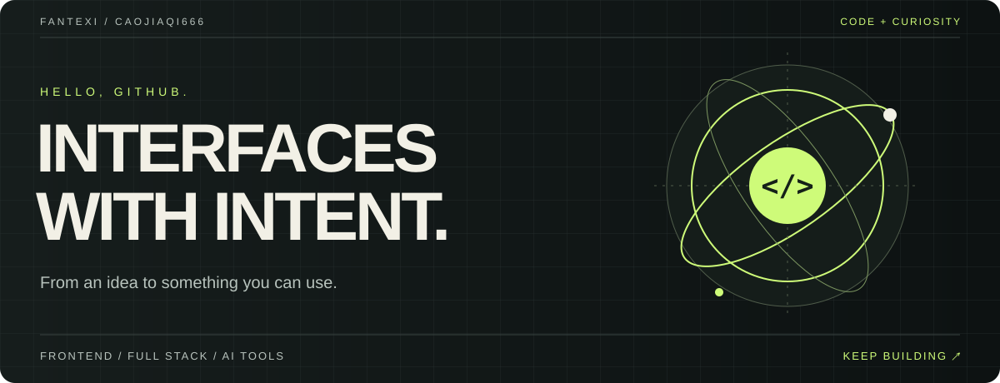

<picture>
  <source media="(max-width: 600px)" srcset="./profile-hero-mobile.svg">
  
</picture>

# Hi, I'm Fantexi · 饭特稀

**写界面，也写界面背后的逻辑。**

从 Vue / React 前端，到 Node.js 服务，再到 AI 命令行工具。这里记录我的开发实践，也留一点空间给新的想法。

[探索我的项目 ↗](https://github.com/caojiaqi666?tab=repositories) · [代码动态](https://github.com/caojiaqi666?tab=overview) · [交流想法](https://github.com/caojiaqi666/caojiaqi666/issues)

## 01 / Toolbox

**界面**　React · Vue · TypeScript · JavaScript  
**服务**　Node.js · Koa · WebSocket  
**工具**　Vite · Electron · Go

技术是工具，把想法做出来才是目的。

## 02 / Selected work

### [pipe ↗](https://github.com/caojiaqi666/pipe)
终端上下文 × AI。面向 Agent 的命令行工具，将自然语言指令与目录上下文连接到 AI，支持结构化输出与 schema 自省。

`Go`　`AI tooling`　`CLI`

### [adminTemplate ↗](https://github.com/caojiaqi666/adminTemplate)
Vue 3 + Vite 模板项目。把日常前端开发的起点整理成可复用的工程骨架。

`Vue 3`　`TypeScript`　`Vite`

### [chatRoom ↗](https://github.com/caojiaqi666/chatRoom)
基于 Koa + WebSocket 的多人在线聊天室。从页面交互走到实时通信。

`Node.js`　`Koa`　`WebSocket`

更多开发实践

- [blogFront](https://github.com/caojiaqi666/blogFront) / [blogServer](https://github.com/caojiaqi666/blogServer) — 博客前端与后端。
- [bug-electron-app](https://github.com/caojiaqi666/bug-electron-app) — Electron + Vue 桌面 bug 管理应用。
- [umi-admin](https://github.com/caojiaqi666/umi-admin) — Umi 后台管理项目。

## 03 / Next to explore

- **AI × 开发工具** — 让上下文流动起来，让工具更容易协作。
- **交互 × 创意可视化** — 尝试把抽象想法变成能看见、能操作的界面。
- **前端 × 全栈** — 持续连接用户体验与背后的实现。

---

保持好奇，把想法写成代码。 / Stay curious. Keep building.
