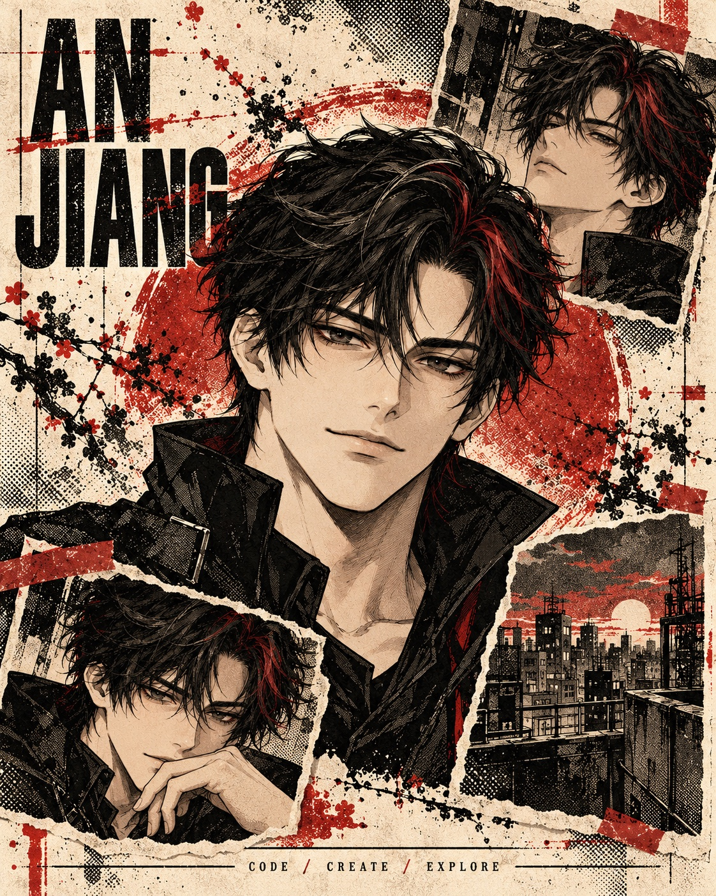

# Hi, I'm An Jiang 👋

**Build useful software. Leave room for imagination.**

- 👨‍💻 I build **frontend and full-stack projects**.
- 🛠️ I work with **React, Vue, TypeScript and JavaScript**.
- ⚙️ My projects also explore **Node.js, Koa and Electron**.
- 🤖 I'm interested in **AI applications and developer tools** — including an Agent-friendly CLI.
- 🎨 I'm exploring **creative visualization** and expressive interfaces.
- 🌱 From blog systems to real-time chat, I learn by **building things**.

**Languages & tools**

React · Vue · TypeScript · JavaScript  
Node.js · Koa · WebSocket · Electron  
Vite · Git · Go

[Browse my projects ↗](https://github.com/caojiaqi666?tab=repositories) · [Say hello](https://github.com/caojiaqi666/caojiaqi666/issues)

 

## Selected projects

### [pipe ↗](https://github.com/caojiaqi666/pipe)
A CLI that connects terminal context to AI. Built with Go, with structured output and schema introspection for Agent workflows.

### [adminTemplate ↗](https://github.com/caojiaqi666/adminTemplate)
A Vue 3 + Vite template project — a practical starting point for frontend development with TypeScript.

### [chatRoom ↗](https://github.com/caojiaqi666/chatRoom)
A multi-user online chat room built with Koa and WebSocket. Exploring the connection between interface and real-time communication.

More experiments

- [blogFront](https://github.com/caojiaqi666/blogFront) / [blogServer](https://github.com/caojiaqi666/blogServer) — frontend and backend for a personal blog.
- [bug-electron-app](https://github.com/caojiaqi666/bug-electron-app) — a desktop bug management app with Electron and Vue.
- [umi-admin](https://github.com/caojiaqi666/umi-admin) — a Umi admin project.

---

Code / Create / Explore — An Jiang

<!-- Artwork: original AI-generated character and collage, created for this profile. No reference author's artwork, franchise character, or brand assets are reused. -->
